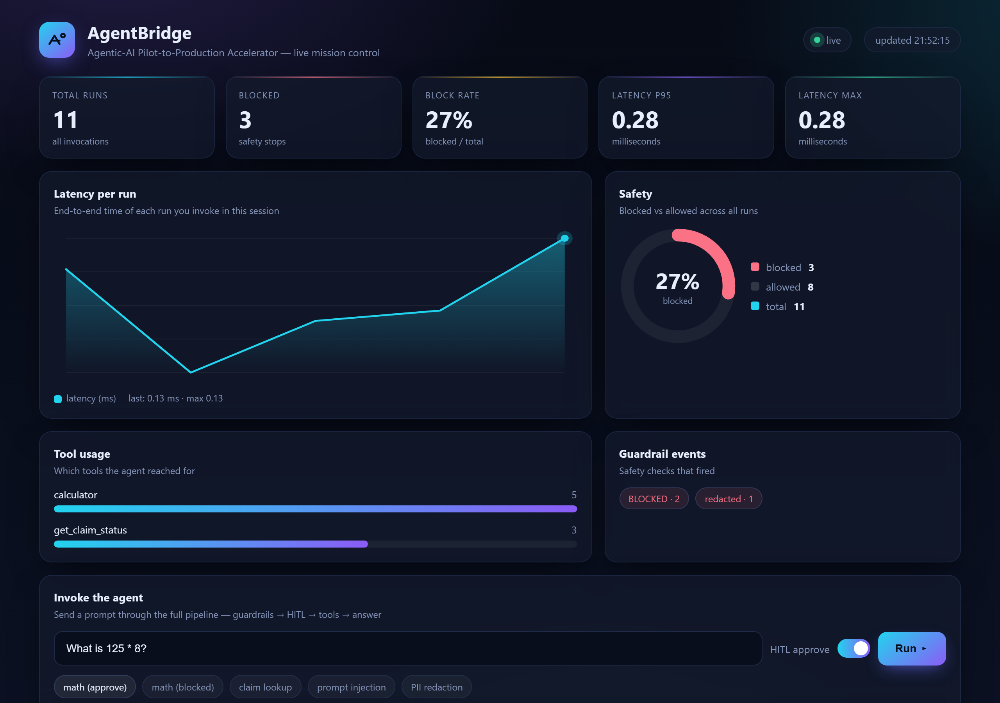

# AgentBridge — Agentic-AI Pilot-to-Production Accelerator

A toolkit that takes a prototype LLM agent and makes it production-ready:
**evaluation before deployment, guardrails during runtime, observability after.**

Built as the portfolio project aligned to Tech Mahindra's "AI Delivered Right"
strategy (see `TechMahindra_Project_Blueprint.pdf`).




*Live observability dashboard — real metrics from the running service: total/blocked
runs, latency p50/p95/max, tool usage, and guardrail events.*

## Quick start (no API key needed)

```bash
python run_demo.py            # run the agent on sample tasks
python run_evals.py           # run the golden eval suite (this is the CI gate)
python -m pytest              # unit tests (54 tests)
uvicorn app:app --host 0.0.0.0 --port 8000   # start API + dashboard
```

Then open **http://127.0.0.1:8000/** for the live dashboard, or
**http://127.0.0.1:8000/docs** for Swagger UI.

The default provider is a deterministic **MockLLM** so everything runs offline.
Drop in a real model by setting an env var — the app auto-detects it:

```bash
# Windows (PowerShell)
$env:GEMINI_API_KEY = "AIza..."     # Google Gemini (REST, stdlib-only — no SDK)
python run_demo.py                  # answers any question for real

$env:OPENAI_API_KEY = "sk-..."      # or OpenAI
python run_demo.py
```

Optional: `$env:GEMINI_MODEL = "gemini-3.5-flash"` to pick a different model
(default `gemini-3.6-flash`). Transient errors (429/5xx) are retried with the
server's own `retryDelay`; if the provider is still down, `/invoke` returns a
graceful `503` with a readable message instead of a stack trace.

> **CI safety:** `run_evals.py` and the test suite are pinned to `MockLLM`, so
> setting a key never makes the eval gate hit the network. Use
> `python run_evals.py --live` to opt in to a real model.

## What's inside (mapped to the 8-week plan)

| Module | Status | Week |
|---|---|---|
| `agentbridge/agent.py` — tool-calling agent loop with trace recording | ✅ done | 1 |
| `agentbridge/llm.py` — pluggable providers (Mock / Gemini / OpenAI) | ✅ done | 1 |
| `agentbridge/tools.py` — tool registry + sample domain tools | ✅ done | 1 |
| `evals/golden_set.json` + `run_evals.py` — golden eval harness (22 cases) | ✅ done | 2 |
| Two gates: functional (100%) + quality vs `evals/baseline.json` | ✅ done | 2 |
| `agentbridge/scoring.py` — heuristic judge + optional LLM-as-judge | ✅ done | 2 |
| `agentbridge/guardrails.py` — injection blocking, PII redaction, tool-output schema validation | ✅ done | 3 |
| Guardrails wired into agent loop (input / tool-output / answer checkpoints) | ✅ done | 3 |
| `agentbridge/hitl.py` — human-in-the-loop approval before tool execution | ✅ done | 4 |
| `Dockerfile` + FastAPI service (`app.py`) | ✅ done | 4–6 |
| `agentbridge/observability.py` — TraceLogger (JSONL persistence + aggregate metrics) | ✅ done | 5 |
| `GET /metrics` — runs, blocked, tool usage, guardrail events, latency p50/p95/max | ✅ done | 5 |
| `static/index.html` — live observability dashboard at `/` | ✅ done | 7 |
| `tests/` — pytest suite (41 tests, CI-ready) | ✅ done | 1–7 |
| `.github/workflows/ci.yml` — CI gate (pytest + evals) | ✅ done | 2 |
| README polish, architecture diagram | ✅ done | 8 |

## Architecture

```
                         ┌─────────────────────────────────────────────┐
                         │                FastAPI (app.py)             │
                         │  GET /  ·  /health  ·  /invoke  ·  /metrics│
                         └───────────────┬─────────────────────────────┘
                                         │ prompt + HITL flag
                                         ▼
                    ┌────────────────────────────────────────┐
                    │        AgentWithHitl (hitl.py)         │
                    │  ┌──────────────────────────────────┐  │
                    │  │ Guardrails (guardrails.py)       │  │
                    │  │  • input injection check         │  │
                    │  │  • PII redaction                 │  │
                    │  │  • tool-output schema validation │  │
                    │  └──────────────────────────────────┘  │
                    │  ┌──────────────────────────────────┐  │
                    │  │ HITL gate — approve/block a tool │  │
                    │  └──────────────────────────────────┘  │
                    └───────────────┬────────────────────────┘
                                    │ tool_call
                                    ▼
                    ┌────────────────────────────────────────┐
                    │  Tool registry (tools.py)              │
                    │  calculator · get_claim_status         │
                    └───────────────┬────────────────────────┘
                                    │ tool result → LLM → final answer
                                    ▼
                    ┌────────────────────────────────────────┐
                    │  TraceLogger (observability.py)        │
                    │  • JSONL file: logs/traces.jsonl       │
                    │  • in-memory aggregates → /metrics     │
                    │  • powers the dashboard (static/)      │
                    └────────────────────────────────────────┘
```

**Request flow:** prompt → input guardrails (injection / PII) → LLM decides
tool vs. answer → HITL approval (per-tool policy) → tool execution →
tool-output schema validation → LLM → output guardrails → final answer.
Every step is recorded as a `TraceStep` and persisted by the TraceLogger.

## API endpoints

| Method | Path | Purpose |
|---|---|---|
| GET | `/` | Live observability dashboard |
| GET | `/docs` | Swagger UI (auto-generated) |
| GET | `/health` | Liveness check → `{"status":"ok"}` |
| POST | `/invoke` | Run the agent — `{ "prompt": "...", "hitl": true/false }` |
| GET | `/metrics` | Aggregates: total/blocked runs, tool usage, guardrail events, latency p50/p95/max |

`hitl: true` enables the human approval gate for the call (demo policy
approves `calculator`); omitted or `false` blocks it (deny-by-default).
The HITL policy is reset on every request — no state leaks between calls.

## Repository conventions

- Plain Python 3.10+, stdlib only for the core (real providers are optional extras).
- `run_evals.py` runs **two gates** and exits non-zero if either fails:
  1. *Functional* — every case must pass its hard checks (100% required).
  2. *Quality* — judge score (correctness, conciseness, groundedness, helpfulness)
     must not drop below `evals/baseline.json`. Accept a new floor with
     `python run_evals.py --update-baseline`.
- Judge is the deterministic heuristic offline; set `OPENAI_API_KEY` to
  switch to an LLM-as-judge automatically.
- Every change: `python run_evals.py && python -m pytest` must pass.
- Runtime data (`logs/traces.jsonl`) is gitignored — traces are local only.

## CI gate

The GitHub Actions workflow (`.github/workflows/ci.yml`) runs on every push and
pull request:

1. `python -m pytest -q` — all 41 unit tests must pass
2. `python run_evals.py` — both eval gates must pass (fails the build on any
   functional regression or quality drop below baseline)

> The workflow file is intentionally kept out of this push (added separately via
> the GitHub web editor). It's a one-time paste — see `docs/deploy.md`.

## Deploy

- **Locally (Docker):** `docker build -t agentbridge .` → `docker run -p 8000:8000 agentbridge`
- **Locally (no Docker):** `pip install -r requirements.txt` → `uvicorn app:app --host 0.0.0.0 --port 8000`
- **Public URL (Render / Railway):** step-by-step in [`docs/deploy.md`](docs/deploy.md)

Example:

```bash
curl -X POST http://localhost:8000/invoke \
     -H "Content-Type: application/json" \
     -d '{"prompt":"What is 125 * 8?","hitl":true}'
# → {"answer":"The result is 1000.","iterations":2,"blocked":false}
```

## Docs

- [`docs/job-materials.md`](docs/job-materials.md) — resume bullets, LinkedIn summary, interview talking points
- [`docs/interview-prep.md`](docs/interview-prep.md) — hard Q&A on architecture, safety, ops, trade-offs
- [`docs/deploy.md`](docs/deploy.md) — deploy to a public URL (Render / Railway)

---

## Roadmap

See Section 6 and Section 9 of `TechMahindra_Project_Blueprint.pdf`.
